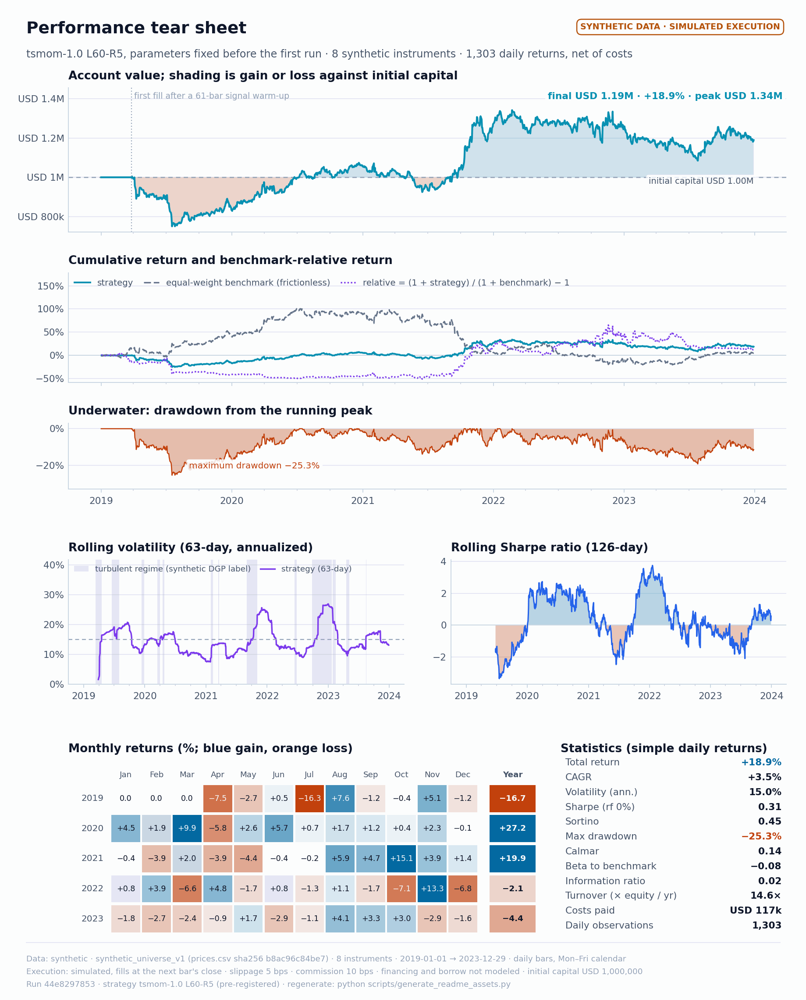
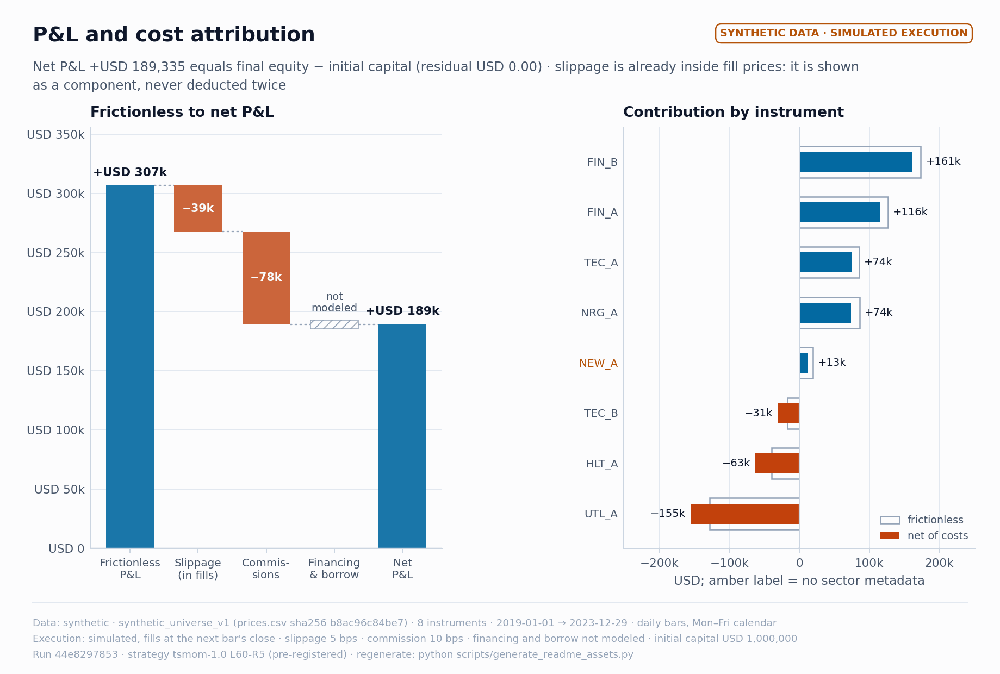
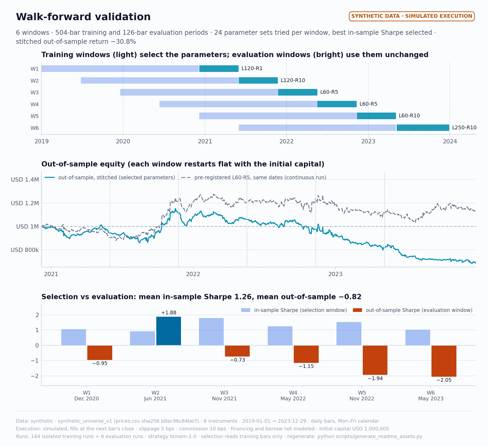
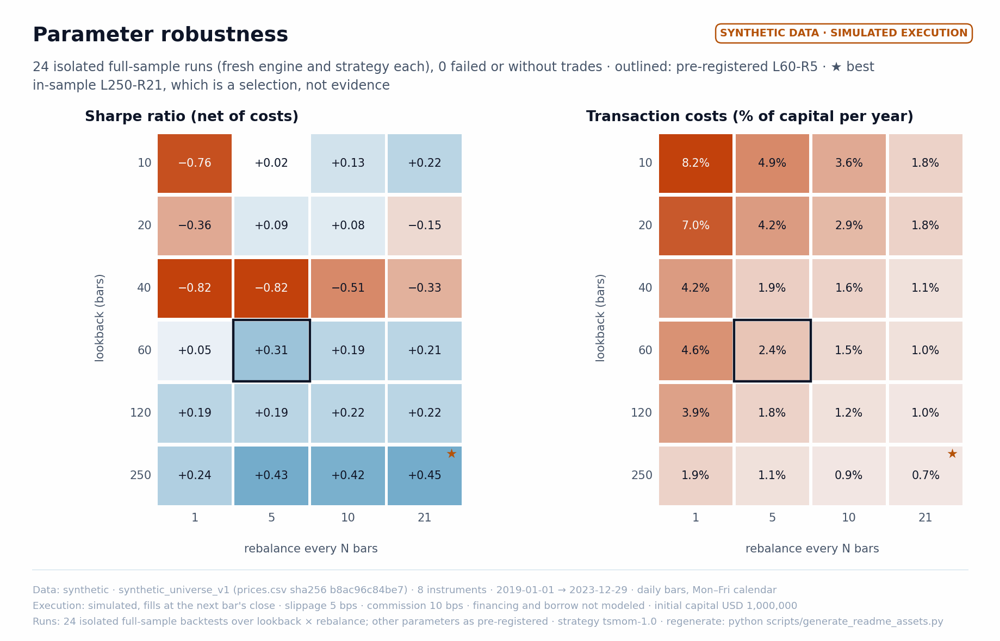
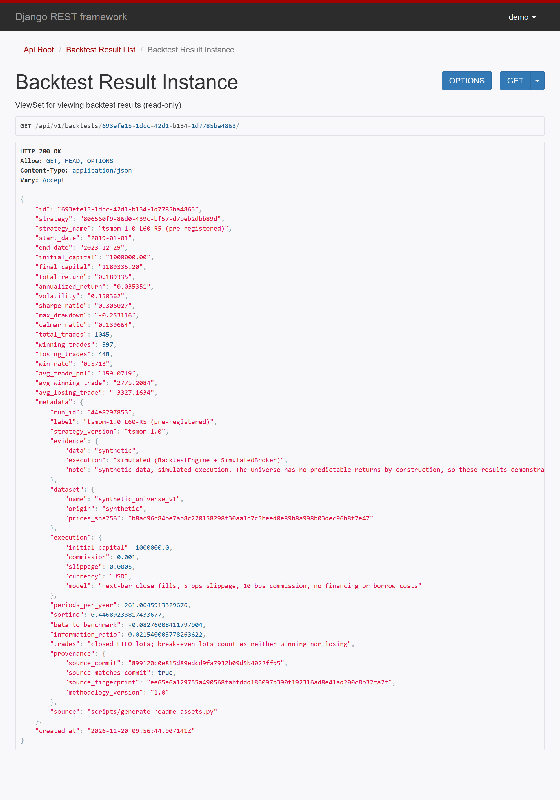
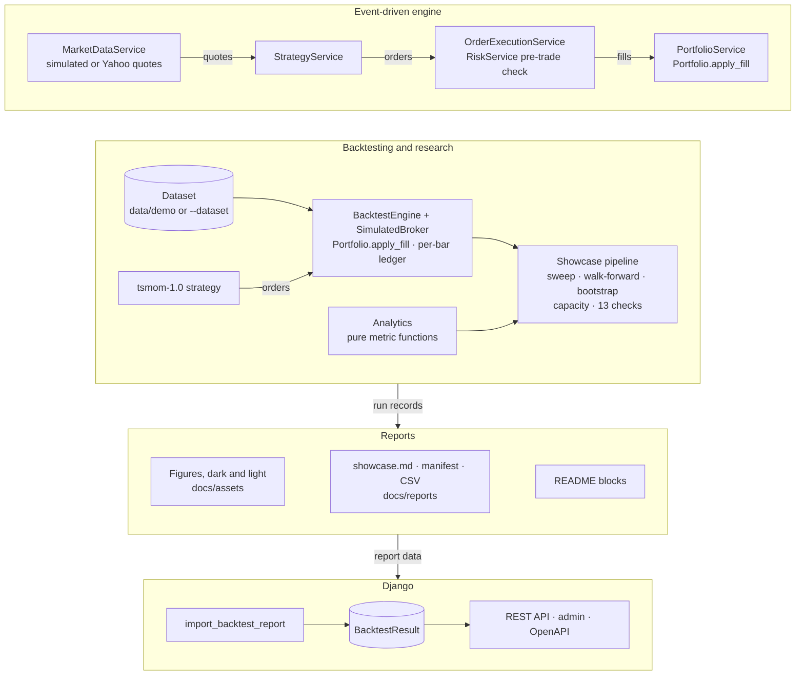
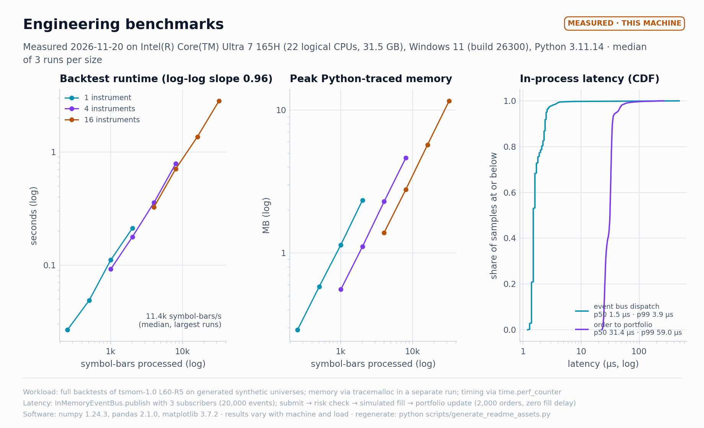

# Quantitative Trading Platform

An event-driven trading engine, a backtester that keeps a per-bar ledger, a research
pipeline that tests its own results out of sample, and a Django REST API that serves them.
Every trade in this repository is simulated.


<picture>
  <source media="(prefers-color-scheme: dark)" srcset="docs/assets/tearsheet-dark.png">
  <source media="(prefers-color-scheme: light)" srcset="docs/assets/tearsheet-light.png">
  
</picture>

> **Evidence category: synthetic data, simulated execution.** The demo universe has no
> predictable returns by construction, so the results below demonstrate the software and
> its accounting, not a profitable strategy. Each figure's tag says whether its numbers are
> simulated, modeled or measured ([definitions](docs/methodology.md#evidence-categories)).

## What it does

| Capability | Code | How it is checked |
| --- | --- | --- |
| Event-driven engine: market data → strategy → pre-trade risk check → simulated execution → portfolio | `src/core`, `src/services` | Unit tests; bounded `live` and `service` runs; order-to-portfolio latency measured |
| Backtester with next-bar fills, costs, a per-bar ledger, an order log with rejection reasons and carried-forward marks for halted instruments | `src/backtesting` | Ledger identity on every bar; engine tests for missing marks and rejections |
| Research pipeline: seeded datasets with checksums, isolated runs with content-hash ids, parameter sweep, walk-forward, block bootstrap, capacity model | `src/research` | 13 consistency checks on every run; nothing is written if one fails |
| Analytics as pure functions: returns and risk, drawdown episodes, tails, exposure, exact P&L attribution, FIFO trade matching | `src/analytics` | Tests on hand-checkable cases; P&L and trades reconcile to the cent |
| Reporting: eleven figures in dark and light, a Markdown report, a manifest, CSV tables and the numbers in this README | `src/reporting`, `scripts/` | One headless command; identical inputs give identical files |
| REST API and admin for accounts, strategies, orders, positions, trades, backtest results and market data | `quantcore/`, `apps/` | Django tests for auth and ownership; screenshot from a real server below |

## Selected results

The pre-registered configuration, `tsmom-1.0` L60-R5, is a time-series momentum rule
with inverse-volatility weights whose parameters were fixed before the first backtest.
It ran on eight synthetic instruments over five years, with fills at the next close,
5 bps slippage and 10 bps commission ([method](docs/methodology.md)).

<!-- showcase:metrics:start -->
| Measure | Value | Basis |
| --- | ---: | --- |
| Total return (5.0 years) | +18.9% | Final equity / initial capital − 1 |
| CAGR | +3.5% | Annualized over 4.99 calendar years |
| Volatility | 15.0% | Daily sd × √261.1 |
| Sharpe ratio | 0.31 | rf = 0%: the simulation pays no interest on cash |
| Max drawdown | −25.3% | Peak 2019-03-28 to trough 2019-07-18; recovered 2020-07-08 |
| Costs paid | USD 117k | USD 78k commission + USD 39k slippage |
| Walk-forward, out of sample | −30.8% | Sharpe −0.74 across 6 evaluation windows |
| Bootstrap P(1-year loss) | 43% | Conditional on this history; not a forecast |
<!-- showcase:metrics:end -->

<!-- showcase:summary:start -->
The pre-registered run returned +18.9% over 5.0 years on data that contains no predictable returns, with a Sharpe ratio of 0.31. The walk-forward evaluation returned −30.8% out of sample, the parameter grid spans Sharpe ratios from −0.82 to +0.45, and the bootstrap puts the chance of a losing year at 43%.
<!-- showcase:summary:end -->

### Where the P&L went

<picture>
  <source media="(prefers-color-scheme: dark)" srcset="docs/assets/attribution-dark.png">
  <source media="(prefers-color-scheme: light)" srcset="docs/assets/attribution-light.png">
  
</picture>

<!-- showcase:attribution:start -->
Frictionless P&L +USD 306,809 − slippage USD 39,158 − commissions USD 78,316 = net +USD 189,335; final equity − initial capital = +USD 189,335 (residual USD 0.00).
<!-- showcase:attribution:end -->

At this turnover, costs take a large share of what the trades earned before costs.
Slippage is already part of each fill price, so the waterfall shows it as one component
of the gap and does not deduct it again. The per-instrument bars add up to the portfolio
result. Financing is labelled as not modeled rather than shown as zero.

### Out of sample, the result does not hold up

<picture>
  <source media="(prefers-color-scheme: dark)" srcset="docs/assets/walk-forward-dark.png">
  <source media="(prefers-color-scheme: light)" srcset="docs/assets/walk-forward-light.png">
  
</picture>

<!-- showcase:walk-forward:start -->
Every training window found a configuration with an in-sample Sharpe ratio of at least 0.92. Out of sample, 1 of 6 evaluation windows made money and the stitched result was −30.8% (Sharpe −0.74); the selected configuration changed 4 times in 6 windows.
<!-- showcase:walk-forward:end -->

Picking the best of 24 configurations on two years of data always finds something that
looks good in sample. On data without predictable returns there is nothing for it to
carry forward. The dashed line runs the pre-registered configuration continuously over
the same dates. Its better result there is no more evidence than the walk-forward's worse
one.

### Every configuration, including the poor ones

<picture>
  <source media="(prefers-color-scheme: dark)" srcset="docs/assets/robustness-dark.png">
  <source media="(prefers-color-scheme: light)" srcset="docs/assets/robustness-light.png">
  
</picture>

<!-- showcase:robustness:start -->
24 configurations (0 failed to run): 7 lost money (negative Sharpe ratio), the best was L250-R21 at +0.45 and the worst L40-R1 at −0.82. The pre-registered L60-R5 ranks 4th of 24.
<!-- showcase:robustness:end -->

Neighbouring cells disagree. Every 40-bar lookback lost money, while every lookback of 60
bars or more made some. A grid over unpredictable data looks like this because
configurations that share signals share their luck. The only systematic pattern is cost,
which falls steadily as rebalancing slows. The starred best cell is a selection, not
evidence.

### The platform serving the run



This is a real page, not a mockup. It shows the Django REST API returning the run after
`manage.py import_backtest_report` stored it. `scripts/capture_api_screenshots.py`
captured the page headless from a development server running on a temporary database.
The metadata carries the evidence category, the dataset checksum and the execution model,
so an API client cannot mistake the record for live results, and the source commit and
fingerprint of the code that produced it.

**More figures.** The [showcase report](docs/reports/showcase.md) has all eleven figures with their tables:

- [Drawdowns and recovery](docs/reports/showcase.md#drawdowns-and-recovery): depth,
  duration and recovery of the five deepest drawdowns, including one still open.
- [Trades and execution](docs/reports/showcase.md#trades-and-execution): fills on the price
  path, FIFO-matched lots, turnover and costs.
- [Return distribution and tails](docs/reports/showcase.md#return-distribution-and-tails):
  empirical VaR and expected shortfall beside fitted normal and Student-t models.
- [Exposure and diversification](docs/reports/showcase.md#exposure-and-diversification):
  long and short exposure, weights with the late listing and halts visible, correlations.
- [Scenario and uncertainty analysis](docs/reports/showcase.md#scenario-and-uncertainty-analysis):
  block-bootstrap one-year outcomes and results by volatility regime.
- [Capital and capacity sensitivity](docs/reports/showcase.md#capital-and-capacity-sensitivity):
  how a square-root impact model erodes returns as capital grows.
- [Engineering benchmarks](docs/reports/showcase.md#engineering-benchmarks): throughput,
  scaling, memory and latency.

## Architecture



- **Live and backtest share accounting.** The event-driven engine (`src/services`) and
  the backtester (`src/backtesting`) apply fills through the same `Portfolio.apply_fill`
  in `src/core`.
- **Every run is isolated.** `src/research` gives each run a fresh engine and strategy,
  and identifies it by a hash of its data, parameters and costs.
- **Figures only draw.** `src/analytics` computes every metric and `src/reporting` only
  renders it, so a figure and a table cannot disagree.
- **Django is a consumer.** `quantcore` and `apps` never import the engine;
  `import_backtest_report` stores the published report.

## Workflow

1. **Data.** `generate_synthetic_universe()` builds the seeded demo universe, or
   `--dataset` loads your own daily bars. Files are validated and checksummed.
2. **Hypothesis first.** The strategy parameters and the cost model were set before the
   first run and are not tuned.
3. **Run.** `BacktestEngine` replays the bars and keeps every order, fill and ledger row.
4. **Try to break it.** The pipeline runs a 24-configuration sweep, walk-forward
   selection inside each training window, a stationary bootstrap and a capacity model.
5. **Check.** 13 consistency checks run; one failure stops the run before anything is
   written.
6. **Publish.** The run produces figures in dark and light, the report, the manifest (with
   the source commit and source, dependency and dataset fingerprints), CSV tables and the
   numbers in this README.
7. **Serve.** `import_backtest_report` stores the run in Django, and the REST API returns
   it.

The last lines `generate_readme_assets.py` printed for the published run:

<!-- showcase:console:start -->
```text
Run 44e8297853 (tsmom-1.0 L60-R5 (pre-registered)) on synthetic data 'synthetic_universe_v1'
  total return +18.9%  CAGR +3.5%  volatility 15.0%  Sharpe 0.31  max drawdown -25.3%
  walk-forward out-of-sample return -30.8%  bootstrap P(1-year loss) 43%
  13/13 consistency checks passed
```
<!-- showcase:console:end -->

## Quick start

Python 3.11 is required (the pinned numpy and scikit-learn have no wheels for 3.12).

```powershell
git clone https://github.com/easensoy/quantitative-trading-platform.git
cd quantitative-trading-platform
uv venv --python 3.11 --seed .venv        # or: py -3.11 -m venv .venv
.\.venv\Scripts\Activate.ps1               # macOS/Linux: source .venv/bin/activate
python -m pip install -r requirements_dev.txt
python -m pytest
python scripts/generate_readme_assets.py --reuse-engineering
```

The last command regenerates every figure, the report and this README's numbers in about
a minute, with no network access and no database. To run the engine, the Django server
with PostgreSQL and Redis, or Celery, see the [development guide](docs/development.md).

## Figure commands

| Command | What it does |
| --- | --- |
| `python scripts/generate_readme_assets.py` | Everything, re-measuring the engineering benchmarks (about 2 minutes) |
| `… --reuse-engineering` | Keeps the stored benchmark results (about 1 minute) |
| `… --only tearsheet,walk-forward --themes dark` | Selected figures and themes |
| `… --regenerate-dataset` | Rebuilds `data/demo` from its specification; the checksums must match |
| `… --dataset DIR --assets-dir build/report/assets --reports-dir build/report` | Your own daily bars; README.md is left alone and `build/` is not tracked |
| `python scripts/capture_api_screenshots.py` | Recaptures the API screenshot with headless Edge or Chrome |
| `python manage.py import_backtest_report docs/reports/showcase --username USER` | Stores the published run in your Django database |

Outputs keep stable names:
- `docs/assets/<figure>-dark.png` and `-light.png`
- [`docs/reports/showcase.md`](docs/reports/showcase.md)
- [`docs/reports/showcase/`](docs/reports/showcase/): `manifest.json`, CSV tables and
  `engineering.json`

The generator stops with exit code 1, before writing anything, if a check fails.

## Testing and benchmarks

`python -m pytest` runs 136 tests in about ten seconds without external services:
- **Engine:** portfolio accounting, the risk flow, and the backtester's ledger, missing
  marks and rejections.
- **Research:** metric definitions on hand-checkable inputs, P&L and trade
  reconciliation, bootstrap determinism, capacity scaling and run isolation.
- **Django:** models, API authentication and ownership, the market-data pipeline and the
  report import.

<!-- showcase:checks:start -->
**13 of 13 consistency checks passed** in this run: business-day calendar, annualization, equity finite and positive, ledger identity, no missing marks, P&L decomposition reconciles, FIFO trades reconcile, slippage counted once, finite headline metrics, benchmark alignment, walk-forward separation, sweep accounted for, no strategy errors. The generator writes nothing if one fails; details are in [the report](docs/reports/showcase.md#consistency-checks).
<!-- showcase:checks:end -->

<picture>
  <source media="(prefers-color-scheme: dark)" srcset="docs/assets/engineering-dark.png">
  <source media="(prefers-color-scheme: light)" srcset="docs/assets/engineering-light.png">
  
</picture>

<!-- showcase:benchmarks:start -->
| Measurement | Result | Method |
| --- | ---: | --- |
| Backtest throughput | 11.4k symbol-bars/s | Median of the largest runs, momentum strategy |
| Largest run | 16 instruments × 2,016 bars in 2.83 s | Median of 3 runs |
| Runtime scaling | exponent 0.96 | Log-log fit of runtime vs symbol-bars (1.0 = linear) |
| Peak traced memory | 11.6 MB | tracemalloc, largest run |
| Event-bus dispatch | p50 1.5 µs, p99 3.9 µs | 20,000 publishes, 3 subscribers |
| Order → portfolio | p50 31.4 µs, p99 59.0 µs | Risk check, simulated fill, portfolio update, in process |

Measured 2026-11-20 on Intel(R) Core(TM) Ultra 7 165H (22 logical CPUs, 31.5 GB), Windows 11 (build 26300), Python 3.11.14.
<!-- showcase:benchmarks:end -->

These timings describe one machine and one Python process, not a production deployment.

## Limitations and status

- **Evidence.** All results come from synthetic data with simulated execution. There is
  no historical market data in the repository, and no paper or live trading. No code path
  connects to a broker; the engine's `live` mode name does not change that.
- **Execution model.**
  - Fills happen at the next close, with fixed slippage and commission.
  - Partial fills, volume limits and market impact are not simulated. Impact exists only
    in the capacity model.
  - Financing, borrow costs and dividends are not modeled.
- **Statistics.** The bootstrap is conditional on one five-year synthetic history. The
  capacity curve is a model with stated parameters, not an observation.
- **One strategy family.** It is there to exercise the tooling.

| Area | Status |
| --- | --- |
| Engine services, backtester, research pipeline, reports | Verified: tests and the checks above |
| Django API, admin, migrations | Verified on SQLite and PostgreSQL 15 |
| Celery worker, Redis cache and Channels | Need Redis; the worker is unverified without it |
| Engine VaR, beta and daily-loss checks | Placeholders (random numbers or always pass) |
| `EVENT_BUS_TYPE=redis` | Incomplete |
| Airflow, dbt and vendor connectors | Legacy, not verified |

The [development guide](docs/development.md#component-status) has the full component table
with the evidence for each row.

## Links

- [Showcase report](docs/reports/showcase.md): all eleven figures, tables and consistency checks
- [Methodology](docs/methodology.md): data-generating process, strategy, execution model,
  metric definitions, validation, provenance and benchmarks
- [Development guide](docs/development.md): setup, configuration, running the engine and
  Django, tests, dependency manifests
- [Report data](docs/reports/showcase/): `manifest.json` with run ids, checksums, source
  provenance and environment; CSV tables
- [Demo dataset](data/demo/synthetic_universe_v1/): prices, instruments, regimes and the
  generator specification
- [Django migration notes](README_DJANGO_MIGRATION.md) and the original
  [architecture notes](README_ARCHITECTURE.md)
