<!-- Generated by scripts/generate_readme_assets.py; edits are overwritten. -->
# Showcase report: time-series momentum on a synthetic universe

> **Evidence category:** Synthetic data, simulated execution. The universe has no predictable returns by construction, so these results demonstrate the software and its accounting, not a profitable strategy.

| | |
| --- | --- |
| Data | synthetic: `synthetic_universe_v1` (8 instruments, 2019-01-01 → 2023-12-29, daily, Mon–Fri calendar), prices.csv sha256 `b8ac96c84be7ab8c`; see [the dataset](../../data/demo/synthetic_universe_v1/) |
| Strategy | `tsmom-1.0` L60-R5, parameters fixed before the first run |
| Execution | next-bar close fills, 5 bps slippage, 10 bps commission, no financing or borrow costs; initial capital USD 1,000,000 |
| Main run | `44e8297853`: 1,065 fills, 1,065 orders, 0 rejected |
| Source | commit `899120c0e815d89edcd9fa7932b09d5b4022ffb5`; source fingerprint `ee65e6a129755a49` over 40 files (scope and per-file hashes in manifest.json) |
| Software | Python 3.11.14, numpy 1.24.3, pandas 2.1.0, scipy 1.11.2, matplotlib 3.7.2, pillow 10.0.0; requirement files fingerprinted in manifest.json |
| Method | [methodology](../methodology.md), version 1.0 |

## Headline results

| Measure | Value | Basis |
| --- | ---: | --- |
| Total return (5.0 years) | +18.9% | Final equity / initial capital − 1 |
| CAGR | +3.5% | Annualized over 4.99 calendar years |
| Volatility | 15.0% | Daily sd × √261.1 |
| Sharpe ratio | 0.31 | rf = 0%: the simulation pays no interest on cash |
| Max drawdown | −25.3% | Peak 2019-03-28 to trough 2019-07-18; recovered 2020-07-08 |
| Costs paid | USD 117k | USD 78k commission + USD 39k slippage |
| Walk-forward, out of sample | −30.8% | Sharpe −0.74 across 6 evaluation windows |
| Bootstrap P(1-year loss) | 43% | Conditional on this history; not a forecast |

The pre-registered run returned +18.9% over 5.0 years on data that contains no predictable returns, with a Sharpe ratio of 0.31. The walk-forward evaluation returned −30.8% out of sample, the parameter grid spans Sharpe ratios from −0.82 to +0.45, and the bootstrap puts the chance of a losing year at 43%.

## Performance tear sheet

Account value, cumulative and benchmark-relative return, drawdown, rolling risk, monthly returns and summary statistics of the pre-registered run.

<picture>
  <source media="(prefers-color-scheme: dark)" srcset="../assets/tearsheet-dark.png">
  <source media="(prefers-color-scheme: light)" srcset="../assets/tearsheet-light.png">
  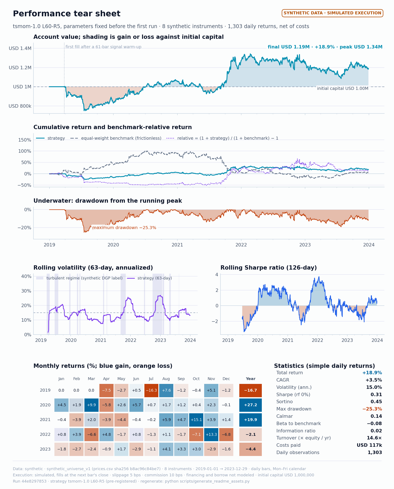
</picture>

## P&L and cost attribution

How frictionless trading P&L becomes net P&L after slippage (inside fill prices) and commissions; financing is not modeled. Per-instrument contributions sum to the portfolio result.

<picture>
  <source media="(prefers-color-scheme: dark)" srcset="../assets/attribution-dark.png">
  <source media="(prefers-color-scheme: light)" srcset="../assets/attribution-light.png">
  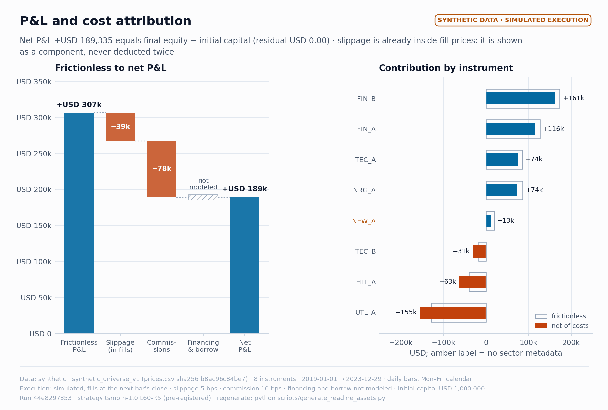
</picture>

Frictionless P&L +USD 306,809 − slippage USD 39,158 − commissions USD 78,316 = net +USD 189,335; final equity − initial capital = +USD 189,335 (residual USD 0.00).

## Trades and execution

Fills on the price path, FIFO-matched closed lots, turnover and costs, and the order → fill → lot accounting.

<picture>
  <source media="(prefers-color-scheme: dark)" srcset="../assets/trades-dark.png">
  <source media="(prefers-color-scheme: light)" srcset="../assets/trades-light.png">
  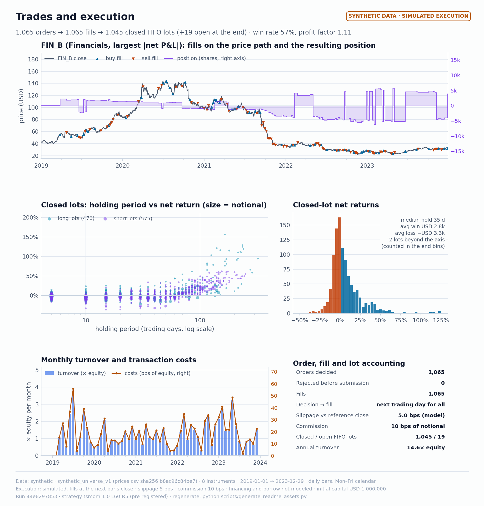
</picture>

1,045 closed FIFO lots, win rate 57.1%, profit factor 1.11, median holding period 35 trading days, annual turnover 14.6× equity.

## Drawdowns and recovery

Depth, duration and recovery of the five deepest drawdowns.

<picture>
  <source media="(prefers-color-scheme: dark)" srcset="../assets/drawdowns-dark.png">
  <source media="(prefers-color-scheme: light)" srcset="../assets/drawdowns-light.png">
  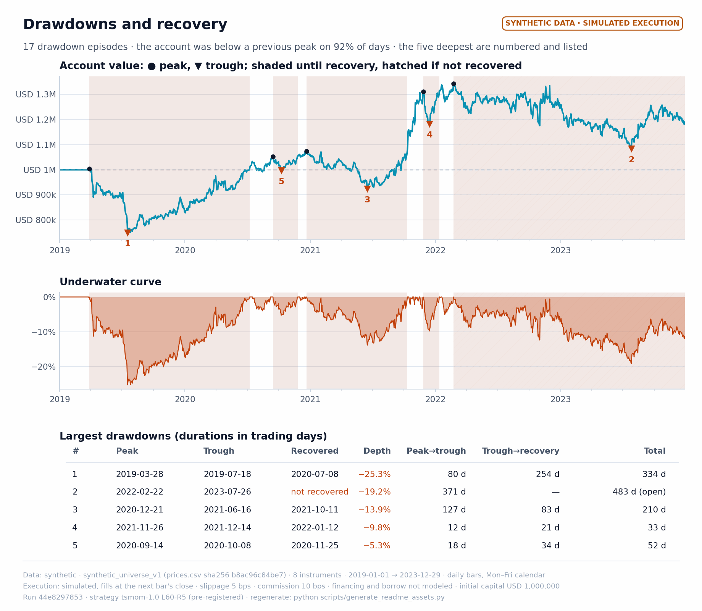
</picture>

| # | Peak | Trough | Recovered | Depth | Peak→trough | Trough→recovery | Total |
| ---: | --- | --- | --- | ---: | ---: | ---: | ---: |
| 1 | 2019-03-28 | 2019-07-18 | 2020-07-08 | −25.3% | 80 d | 254 d | 334 d |
| 2 | 2022-02-22 | 2023-07-26 | not recovered | −19.2% | 371 d | — | 483 d |
| 3 | 2020-12-21 | 2021-06-16 | 2021-10-11 | −13.9% | 127 d | 83 d | 210 d |
| 4 | 2021-11-26 | 2021-12-14 | 2022-01-12 | −9.8% | 12 d | 21 d | 33 d |
| 5 | 2020-09-14 | 2020-10-08 | 2020-11-25 | −5.3% | 18 d | 34 d | 52 d |

## Return distribution and tails

Empirical tail estimates next to fitted normal and Student-t models, and a normal Q–Q plot.

<picture>
  <source media="(prefers-color-scheme: dark)" srcset="../assets/distribution-dark.png">
  <source media="(prefers-color-scheme: light)" srcset="../assets/distribution-light.png">
  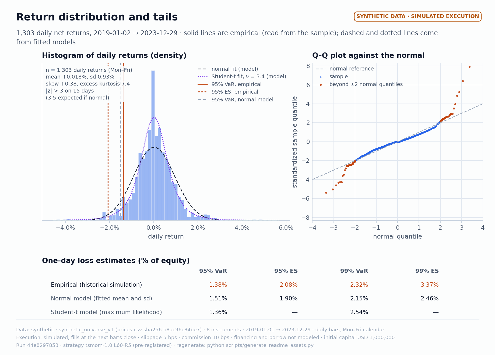
</picture>

## Exposure and diversification

Long/short exposure, instrument weights with listing and warm-up gaps, correlations and effective breadth.

<picture>
  <source media="(prefers-color-scheme: dark)" srcset="../assets/exposure-dark.png">
  <source media="(prefers-color-scheme: light)" srcset="../assets/exposure-light.png">
  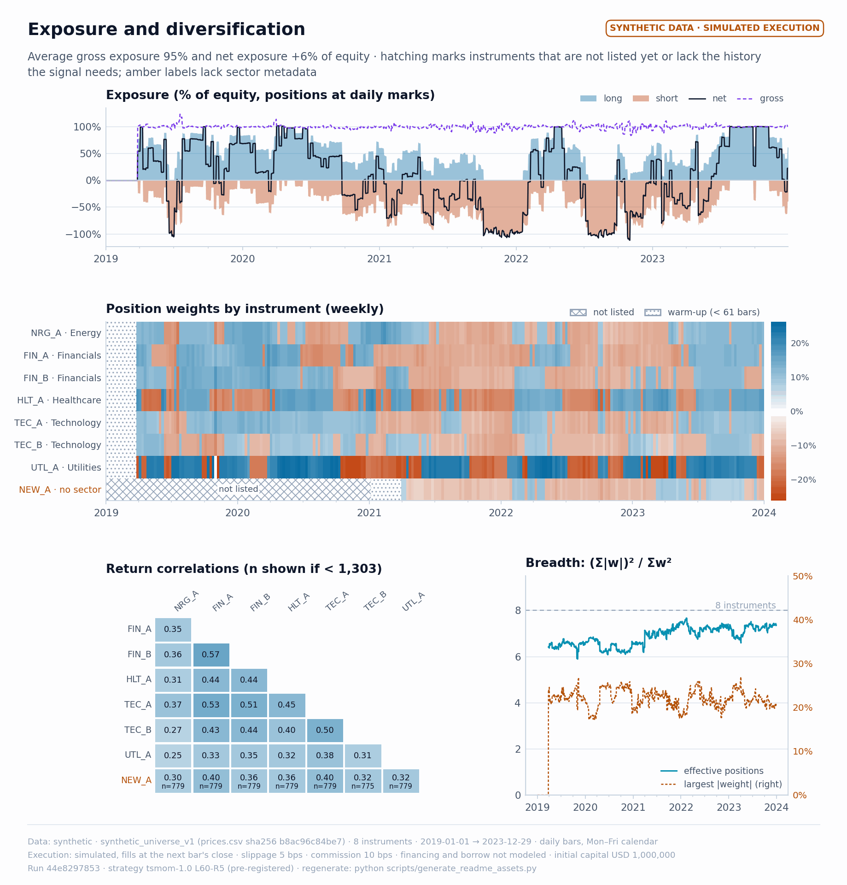
</picture>

## Walk-forward validation

Parameters chosen on two-year training windows, then evaluated unchanged on the following six months.

<picture>
  <source media="(prefers-color-scheme: dark)" srcset="../assets/walk-forward-dark.png">
  <source media="(prefers-color-scheme: light)" srcset="../assets/walk-forward-light.png">
  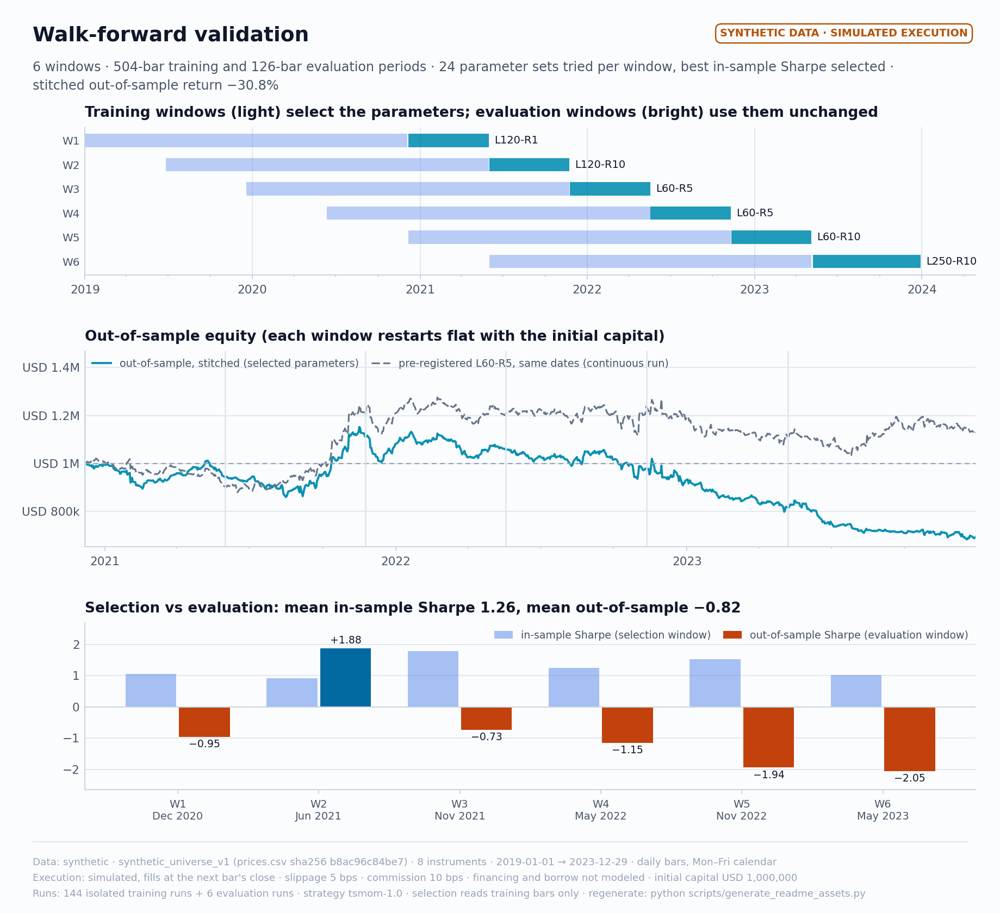
</picture>

| Window | Training | Evaluation | Selected | In-sample Sharpe | Out-of-sample Sharpe | Out-of-sample return |
| ---: | --- | --- | --- | ---: | ---: | ---: |
| 1 | 2019-01-01 → 2020-12-04 | 2020-12-07 → 2021-05-31 | L120-R1 | 1.06 | −0.95 | −5.6% |
| 2 | 2019-06-26 → 2021-05-31 | 2021-06-01 → 2021-11-23 | L120-R10 | 0.92 | +1.88 | +17.9% |
| 3 | 2019-12-19 → 2021-11-23 | 2021-11-24 → 2022-05-18 | L60-R5 | 1.79 | −0.73 | −4.8% |
| 4 | 2020-06-12 → 2022-05-18 | 2022-05-19 → 2022-11-10 | L60-R5 | 1.25 | −1.15 | −7.7% |
| 5 | 2020-12-07 → 2022-11-10 | 2022-11-11 → 2023-05-05 | L60-R10 | 1.54 | −1.94 | −16.4% |
| 6 | 2021-06-01 → 2023-05-05 | 2023-05-08 → 2023-12-29 | L250-R10 | 1.03 | −2.05 | −15.4% |

Every training window found a configuration with an in-sample Sharpe ratio of at least 0.92. Out of sample, 1 of 6 evaluation windows made money and the stitched result was −30.8% (Sharpe −0.74); the selected configuration changed 4 times in 6 windows.

## Parameter robustness

Every configuration of the lookback × rebalance grid, including the poor ones.

<picture>
  <source media="(prefers-color-scheme: dark)" srcset="../assets/robustness-dark.png">
  <source media="(prefers-color-scheme: light)" srcset="../assets/robustness-light.png">
  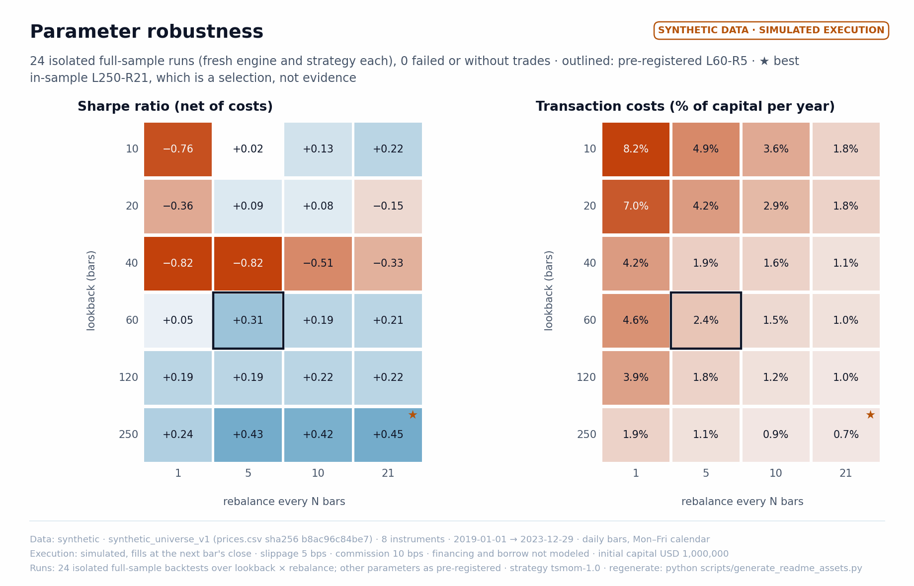
</picture>

24 configurations (0 failed to run): 7 lost money (negative Sharpe ratio), the best was L250-R21 at +0.45 and the worst L40-R1 at −0.82. The pre-registered L60-R5 ranks 4th of 24.

## Scenario and uncertainty analysis

Block-bootstrap distributions of one-year outcomes and performance by volatility regime.

<picture>
  <source media="(prefers-color-scheme: dark)" srcset="../assets/uncertainty-dark.png">
  <source media="(prefers-color-scheme: light)" srcset="../assets/uncertainty-light.png">
  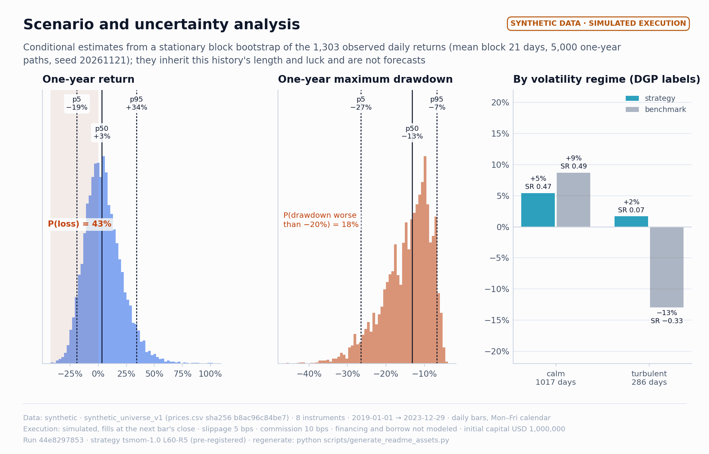
</picture>

## Capital and capacity sensitivity

A cost model, not a simulation: modeled net return and participation as capital grows.

<picture>
  <source media="(prefers-color-scheme: dark)" srcset="../assets/capacity-dark.png">
  <source media="(prefers-color-scheme: light)" srcset="../assets/capacity-light.png">
  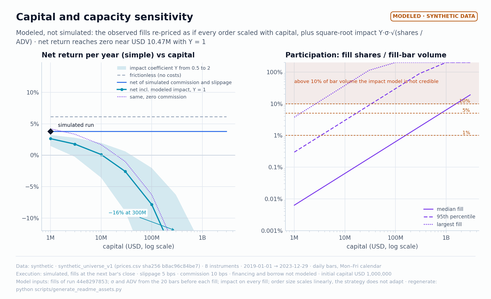
</picture>

| Capital | Frictionless | Commission | Slippage | Modeled impact | Net (modeled) | Median participation |
| ---: | ---: | ---: | ---: | ---: | ---: | ---: |
| USD 1.00M | +6.1% | −1.6% | −0.8% | −1.2% | +2.6% | 0.006% |
| USD 3.00M | +6.1% | −1.6% | −0.8% | −2.0% | +1.8% | 0.019% |
| USD 10.00M | +6.1% | −1.6% | −0.8% | −3.7% | +0.1% | 0.063% |
| USD 30.00M | +6.1% | −1.6% | −0.8% | −6.4% | −2.6% | 0.190% |
| USD 100.00M | +6.1% | −1.6% | −0.8% | −11.6% | −7.8% | 0.635% |
| USD 300.00M | +6.1% | −1.6% | −0.8% | −20.2% | −16.4% | 1.905% |
| USD 1.0B | +6.1% | −1.6% | −0.8% | −36.8% | −33.0% | 6.350% |
| USD 3.0B | +6.1% | −1.6% | −0.8% | −63.7% | −59.9% | 19.049% |

## Engineering benchmarks

Measured runtime, memory and in-process latency.

<picture>
  <source media="(prefers-color-scheme: dark)" srcset="../assets/engineering-dark.png">
  <source media="(prefers-color-scheme: light)" srcset="../assets/engineering-light.png">
  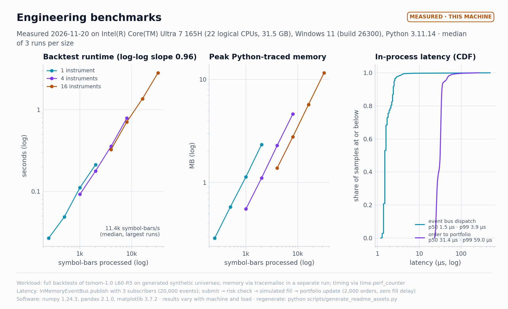
</picture>

| Measurement | Result | Method |
| --- | ---: | --- |
| Backtest throughput | 11.4k symbol-bars/s | Median of the largest runs, momentum strategy |
| Largest run | 16 instruments × 2,016 bars in 2.83 s | Median of 3 runs |
| Runtime scaling | exponent 0.96 | Log-log fit of runtime vs symbol-bars (1.0 = linear) |
| Peak traced memory | 11.6 MB | tracemalloc, largest run |
| Event-bus dispatch | p50 1.5 µs, p99 3.9 µs | 20,000 publishes, 3 subscribers |
| Order → portfolio | p50 31.4 µs, p99 59.0 µs | Risk check, simulated fill, portfolio update, in process |

Measured 2026-11-20 on Intel(R) Core(TM) Ultra 7 165H (22 logical CPUs, 31.5 GB), Windows 11 (build 26300), Python 3.11.14.

## Consistency checks

The generator stops with an error if any of these fail.

| Check | Result | Detail |
| --- | --- | --- |
| Business-day calendar | pass | 1304 bars, no weekend or duplicate timestamps |
| Annualization | pass | 261.1 return observations per calendar year over 4.99 years; calendar: business days (Mon-Fri), no exchange holidays; a fixed 252 would understate volatility by 1.8% |
| Equity finite and positive | pass | min 750,387, max 1,341,832 |
| Ledger identity | pass | max \|equity - (cash + positions at marks)\| = 6.98e-10 |
| No missing marks | pass | 0 open positions without a mark; 5 bars used a carried-forward close |
| P&L decomposition reconciles | pass | frictionless - slippage - commissions = 189,335.20; equity change = 189,335.20 |
| FIFO trades reconcile | pass | realized 166,230.18 + open 23,105.02 vs 189,335.20 |
| Slippage counted once | pass | slippage is inside fill prices; shown as a component, not deducted again |
| Finite headline metrics | pass | all finite |
| Benchmark alignment | pass | 1303 of 1303 strategy dates have a benchmark return |
| Walk-forward separation | pass | 6 windows; every test window starts after its training window ends |
| Sweep accounted for | pass | 24 runs, 0 not ok (kept in the report) |
| No strategy errors | pass | 0 errors during the main run |

## Files

In [showcase/](showcase/):

- `manifest.json`: configuration, provenance (source commit, source, dependency and dataset fingerprints, versions), run ids, checks and environment
- CSV tables: metrics, monthly returns, drawdowns, P&L by instrument, parameter sweep, walk-forward, bootstrap quantiles, regimes, capacity, trade statistics
- `engineering.json`: benchmark results, reused with `--reuse-engineering`
